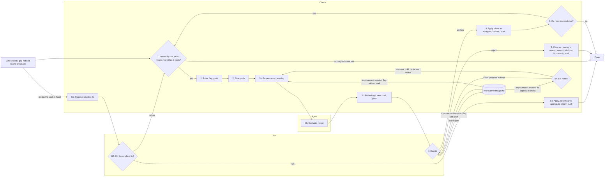

# Continuous Improvement

Status: designed 17 November 2026; no real run yet

**Objective:** Every gap found in a workflow or in the working rules gets resolved, so the system gets better with use instead of drifting.

**Place in the system:** a support workflow. Every formally designed workflow in `.claude/skills/` raises flags into it, including this one. It also takes gaps in [`CLAUDE.md`](../../../CLAUDE.md). Design a Workflow sends it every need that is a change or an extension of an existing workflow. It sends Design a Workflow every gap that needs a new workflow.

## SIPOC

| Supplier | Input | Process | Output | Customer |
|---|---|---|---|---|
| Me; Claude; Design a Workflow (a change or an extension); the session close's plan-vs-actual table | A gap, noticed during a real session | Raise → Size → Propose → Evaluate → Save → Decide → Apply → Re-read | Updated workflow files or `CLAUDE.md`; each flag closed as accepted or rejected | Every workflow; Design a Workflow (a gap that needs a new workflow); me |

## Steps

| # | Step | Lane |
|---|---|---|
| 1 | **Raise.** A gap shows up when I name it, or when Claude notices it in any session. Claude states in one line what the fix returns: less work for me, higher quality, or a risk removed. Claude also states what the fix costs (files and steps it touches), what it removes or merges, and whether the gap will recur. Claude does not raise a gap that it noticed if the fix returns nothing concrete, or costs more than it returns. Claude says so in one line. A gap that I named is always raised. A gap that needs a new workflow goes to Design a Workflow, step 1, not here. To raise a flag, Claude pulls and reads the *Next ID* line of [`improvement/flags.md`](../../../improvement/flags.md). Claude adds a row to *Open*: ID, title, raised (date, by), target (file and step), issue in one line, status *open*. Claude updates the *Next ID* line in the same write. Claude pushes at once and tells me the flag's ID and title. Claude also raises a flag when I give the same correction to the same kind of work a second time. The flags, or the past chats where Claude can read them, show the repeat. The flag names both occasions. | Claude |
| 2 | **Size.** Claude writes the size in the flag's *Size* cell, with a one-line reason, and pushes. **Small:** it changes the wording of one step or rule in one file. **Large:** it adds, removes or reorders steps, changes a lane, touches more than one file, or changes a data file's structure. The size tells me how much the decision takes. | Claude |
| 3a | **Propose.** Claude drafts the fix in exact wording. The draft includes the wording for every other workflow and file that the fix changes (the propagation check). Claude adds one or two plain sentences: what changes in what the system does for me, and what stays as it is. | Claude |
| 3b | **Evaluate.** An evaluator checks the draft ([`CLAUDE.md`](../../../CLAUDE.md), *How Claude works with me*) and reports its findings. | Agent |
| 3c | **Fix and save.** Claude fixes what the evaluator found, for a maximum of 3 rounds. Claude saves the draft under *Proposed wording* in [`improvement/flags.md`](../../../improvement/flags.md), with the state *draft*. A new draft for the same flag replaces the text under its heading; git keeps the old text. Claude pushes. | Claude |
| 4 | **Decide.** I confirm, reject, or leave the flag open for an improvement session. I decide each flag on its own. I can also change the size here. | Me |
| 5 | **Apply.** On my confirmation, Claude sets the wording's state to *confirmed*. Claude edits the target files exactly as worded. Claude moves the row to *Closed*, with status *accepted* and a one-line resolution (what changed). On my rejection, Claude sets the wording's state to *rejected*. For a blocking-fix flag, a revert that I confirm restores the old text. Claude moves the row to *Closed*, with status *rejected* and my reason as the resolution. Claude makes one commit per flag, with the flag ID and title in the message, then pushes. If the confirmed wording no longer fits its target, Claude does not improvise. This happens when the text that it replaces has changed, or when its target no longer exists. Claude says why and drafts new options (step 3a). | Claude |
| 6 | **Re-read.** After a fix, Claude re-reads the changed file end to end against its Objective. Claude also re-reads every other workflow and file that refers to it. Any contradiction it finds becomes a new flag (back to step 1), not a silent correction. | Claude |

**Improvement session.** I open an improvement session when I want to work through open flags. Claude takes them in order of what depends on them. First come flags on [`CLAUDE.md`](../../../CLAUDE.md), then flags on the workflows that other workflows call, then the rest. Claude prepares flags that touch the same file together, so each file is read and edited once. A flag with a saved draft goes to step 4 with that draft, unless its target changed since the draft. Then it goes back to step 3a. A flag without a draft starts at step 3a. A flag with the status *fix applied, to check* goes through step B4.

## Blocking fix

A gap can block the work in hand. Then the flag follows these steps in place of steps 1 to 5.

| # | Step | Lane |
|---|---|---|
| B1 | **Propose the smallest fix.** Claude says what is blocked. Claude proposes the smallest fix that unblocks the work, in exact wording. | Claude |
| B2 | **Decide.** I OK the fix, or I refuse it. A refused fix becomes a normal flag (step 1). | Me |
| B3 | **Apply and raise.** Claude applies the fix exactly as worded. Claude raises the flag as in step 1, with status *fix applied, to check* and a size (step 2). Claude saves the wording under *Proposed wording*, with the state *applied as blocking fix*. Claude commits and pushes. | Claude |
| B4 | **Check.** At the next improvement session, Claude checks the fix against its wording and against the target's Objective. If both hold, Claude proposes to keep the fix. If not, Claude drafts a replacement or a revert (steps 3a to 3c). I decide at step 4, and step 5 applies my decision: keep or replace (*accepted*), or revert (*rejected*). | Claude |

## Swimlane

## Non-negotiables

- **Nothing in a workflow or in `CLAUDE.md` changes without my confirmation, even when the fix is small.** *Reason:* the system is mine; a silent change erodes trust in every file.
- **Every proposed fix is shown in its exact wording before I decide.** *Reason:* I confirm the words that will be written, not a summary of them.
- **One flag at a time; never approve several with one "yes."** *Reason:* a bundled yes hides a change I did not mean to approve.
- **A rejected flag is closed, not left pending. It keeps its reason.** *Reason:* the same idea can then be judged against why it was rejected before.
- **Flags are never deleted. IDs are never reused.** *Reason:* the history of why the system is as it is stays readable.
- **Workflows aren't changed silently: every change traces back to a flag.** This has two exceptions: a new workflow or a redesign through Design a Workflow, and the record of a first real run (Design a Workflow, step 13). *Reason:* git and `improvement/flags.md` together explain every change.
- **Before each push that writes wording I confirmed, Claude compares the written text with the confirmed wording, item by item.** Claude corrects any difference before the push. *Reason:* an edit can cut confirmed wording without notice.

## Data files

- [`improvement/flags.md`](../../../improvement/flags.md) — every flag, open and closed, with its wording. Git keeps the history.
- The target files of each flag — any workflow's `SKILL.md`, or [`CLAUDE.md`](../../../CLAUDE.md) — edited at step 5 and step B3.
- Git is each workflow's changelog: one commit per flag, with the flag ID in the message (`git log -- .claude/skills/<name>/`).

## Open design questions

_(none)_
