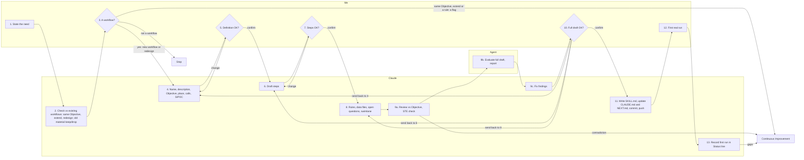

# Design a Workflow

Status: designed 17 November 2026; no real run yet

**Objective:** Turn a need that keeps coming back into a formally designed workflow that runs as written, so every workflow in the system is built the same way.

**Place in the system:** a support workflow. It builds every new workflow, and redesigns an existing workflow when its Objective changes. Every other change to an existing workflow goes through Continuous Improvement, which sends here every gap that needs a new workflow.

## The standard: what every workflow has

Every workflow lives in `.claude/skills/<name>/SKILL.md`. The `<name>` is short, in lowercase, with hyphens between words (for example `weekly-meal-plan`). The file has:

1. Frontmatter at the top, between two `---` lines: `name:` (the same as the folder name) and `description:` (what the workflow does and when to use it, so that Claude can find it)
2. A Status line: `Status: designed DD Month YYYY; first real run DD Month YYYY` (until then: `no real run yet`). A real run is a use on a real case that reaches the workflow's last step.
3. Objective, one sentence
4. Place in the system: part of a larger workflow, a support workflow, or a tool called from inside another workflow; which workflows call it and which it calls
5. SIPOC
6. Steps table, one lane per step (Me, Claude or Agent)
7. Swimlane, drawn from the steps table
8. Non-negotiables, each with its reason
9. Data files it reads and writes
10. Open design questions

## SIPOC

| Supplier | Input | Process | Output | Customer |
|---|---|---|---|---|
| Me (a need); Continuous Improvement (a gap that needs a new workflow); old material I bring | The need, plus any old material I attach or point to | Need → Check → Define → Steps → Rules and swimlane → Review → Write → First run → Record | `.claude/skills/<name>/SKILL.md`, "no real run yet" | Me; the workflows that call it |

## Steps

| # | Step | Lane |
|---|---|---|
| 1 | **State the need.** What keeps recurring, and what prompts it now. | Me |
| 2 | **Check it earns a workflow.** Claude tests the need against every existing workflow, in order. (a) *Same Objective* → a change, to Continuous Improvement as a flag. (b) *Extend:* an existing workflow covers it by adding a step, source, branch or output, and its Objective still fits in one sentence → an extension, to Continuous Improvement as a flag naming that workflow. (c) *Redesign:* covering it changes an existing Objective → a redesign, continuing here. Only if all three tests fail is it a new workflow. A one-off task or a data file is not a workflow. A rule is not a workflow: it goes to Continuous Improvement as a flag on `CLAUDE.md`. Claude states which test decided it and why. If old material exists, Claude lists what to keep and what to drop. | Claude |
| 3 | **Checkpoint 1: is it a workflow?** I confirm a new workflow or a redesign, send it to Continuous Improvement as a flag, or stop. | Me |
| 4 | **Define it.** Claude proposes the name, the frontmatter description, the Objective, its place in the system, what calls it and what it calls, and the SIPOC. Claude lists every existing workflow and data file that would have to change as a result. Claude makes those changes at step 11, in the same commit. | Claude |
| 5 | **Checkpoint 2: definition.** I confirm or change it. | Me |
| 6 | **Draft the steps.** One lane per step. Every decision I make is its own step. A call to a nested workflow is its own named step. | Claude |
| 7 | **Checkpoint 3: steps.** I confirm or change them. | Me |
| 8 | **Draft the rest.** Non-negotiables with their reasons, data files, open questions, and the swimlane drawn from the steps table. | Claude |
| 9a | **Review.** Claude reads the whole design against its Objective. Claude proposes to remove a step that does not serve the Objective. A contradiction with another workflow becomes a flag. Claude checks that the wording follows the ASD-STE100 writing rules ([`CLAUDE.md`](../../../CLAUDE.md), *How Claude works with me*). | Claude |
| 9b | **Evaluate.** An evaluator checks the full draft (same section of `CLAUDE.md`) and reports its findings. | Agent |
| 9c | **Fix.** Claude fixes what the evaluator found, for a maximum of 3 rounds (same section of `CLAUDE.md`). | Claude |
| 10 | **Checkpoint 4: full draft.** I confirm, or send it back to the step that needs changing (4, 6 or 8). | Me |
| 11 | **Write.** Claude writes `.claude/skills/<name>/SKILL.md` to the standard above. A redesign adds "redesigned DD Month YYYY" to its Status line. Claude adds the workflow to the list in [`CLAUDE.md`](../../../CLAUDE.md), *Where things are*. If the workflow starts a new stream, Claude adds the stream's line to *Streams* in [`NEXT.md`](../../../NEXT.md). Claude deletes the workflow's draft in `drafts/`, if there is one. In *Next*, Claude removes the line that started this design and any line that points to the draft. Claude adds the line "First real run of `<name>`". Claude commits with the message "Add workflow `<name>`", then pushes. Claude registers the clone again, if the session offers a tool for it, so that the new workflow loads. If not, Claude reads the new `SKILL.md` directly when I use it in this session. | Claude |
| 12 | **First real run.** I use the workflow on a real case. | Me |
| 13 | **Record the first run.** At the close of the session with the first real run, Claude writes its date in the Status line ([`CLAUDE.md`](../../../CLAUDE.md), *Sessions*). Claude removes the "First real run" line from *Next*. This is a record of a fact, not a fix, so it needs no flag. Gaps found in the run go to Continuous Improvement. | Claude |

## Swimlane

## Non-negotiables

- **Four checkpoints, each confirmed before the next part is drafted; no `SKILL.md` is written before checkpoint 4.** *Reason:* a wrong Objective makes every later step wrong.
- **A design not finished at session close is saved as a draft.** With my OK at the close, Claude writes `drafts/<name>.md` (before checkpoint 2, `<name>` is a working name). The draft has a line "Resume at step N", then everything confirmed so far. *Next* in `NEXT.md` points to the draft, in place of the line that started the design. The next session picks up from the draft. *Reason:* a session's workspace is not kept, so confirmed checkpoints would be lost.
- **One Objective, one workflow.** Same Objective as an existing workflow means a change, which goes to Continuous Improvement. *Reason:* this stops two workflows that do the same job.
- **Old material is inspiration only:** never copied in wholesale. *Reason:* carrying everything forward brings back the overhead of the old way of working.
- **Every step has exactly one lane; every decision I make is its own step; every nested-workflow call is a named step.** *Reason:* a decision buried inside a step gets skipped.
- **The steps table is the source; the swimlane is drawn from it, never the reverse.** *Reason:* when a diagram and a text are edited separately, they drift apart.
- **Every non-negotiable states its reason.** *Reason:* a rule nobody can explain can't be judged later.
- **Smaller is better:** a step that does not serve the Objective is removed. *Reason:* every extra step costs time on every run.
- **"No real run yet" until it has run on a real case; never called proven before that.** *Reason:* only a real run shows whether the design works.
- **A retired workflow's folder is deleted in the change that retires it; git keeps it.** The flag that retires it records what absorbed it. The workflow list in `CLAUDE.md` is updated in the same change. *Reason:* one place per workflow; nothing retired sits beside what is current.

## Data files

- Old material I attach or point to — read at step 2
- `.claude/skills/<name>/SKILL.md` — written at step 11; its Status line updated at step 13
- [`CLAUDE.md`](../../../CLAUDE.md) (workflow list in *Where things are*) — updated at step 11
- [`NEXT.md`](../../../NEXT.md) (*Streams*, *Next*) — updated at step 11, at step 13, and at session close when a draft is saved
- `drafts/<name>.md` — written at session close when a design is not finished; deleted at step 11
- [`improvement/flags.md`](../../../improvement/flags.md) — written when I send a need to Continuous Improvement at step 3, or step 9a finds a contradiction
- Files listed at step 4 — changed at step 11

## Open design questions

_(none)_
